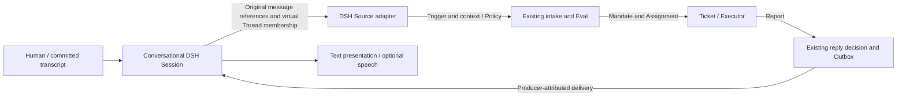

# DSH Source design proposal

**Status: design only; not implemented.** This document proposes a `dsh` Source for a conversational DSH Session, including a voice assistant whose speech has already been transcribed. It does not add a Source, tools, routes, a voice interface, configuration or runtime behavior. Implementation requires separate authorization.

This proposal uses the domain in [001 Domain model](001-domain.md), the permissions in [002 Authorization](002-authorization.md), and the extension points in [008 Cookbook](008-cookbook.md). All identifiers and dialogue examples below are fictional. No private conversation or audio is included.

## 1. Decision and limits

Use the same conceptual structure as Feishu:

| Feishu | Proposed DSH equivalent |
| --- | --- |
| Source kind `feishu` | Source kind `dsh` |
| Chat id | The conversational assistant's DSH `session_id` |
| Root-message/thread id | A stable virtual `thread_id` maintained by the conversational assistant |
| Message id | A stable committed DSH `message_id` |
| Reply to a message in a chat | Deliver a producer-attributed reply to that message's Session and virtual Thread |

The conversational assistant chats and maintains virtual Threads. Superagent alone decides whether a message starts, continues or stops a Ticket and manages Executors. Thread membership is conversation organization, **not permission to start work**. The assistant sends references to original messages, not a rewritten task specification.

A Session may stay available indefinitely, while its virtual Threads identify different conversations and its Tickets finish normally. Do not make the whole Session a permanent Ticket or a shared subscribed parent Thread. Returning to a topic reuses its virtual Thread; changing topics does not require a new DSH Session.

**Recommended first integration:** an in-process Source plugin on the same DSH host as the conversational Session. Use host-authenticated Session events/history, source-owned membership storage and producer-attributed replies. A remote voice application can transcribe into that Session, but a remote-to-superagent bridge is not assumed to exist.

Non-goals: choosing an ASR/TTS vendor, building the voice UI, changing core routing semantics, giving the assistant worker-management tools, merging independent Session histories, and guaranteeing perfect automatic topic classification. This is an architecture and interaction contract, not a pixel-level UI design.

## 2. What already exists, and what does not

Repository baseline: `8c32a9dc5d72c033816c6a8110b37f40cf94fba4`. These are present interfaces, not claims that this proposal works today:

| Existing capability | Evidence | Consequence |
| --- | --- | --- |
| Pluggable kind, configuration, Policy, Channel and assessment context | [SourceKind](../src/sources/kind.ts), [SourceRegistry](../src/sources/registry.ts) | A new Source need not change Ticket or Executor responsibilities |
| Idempotent Trigger intake and subscription fan-out | [Intake](../src/core/intake.ts) | Stable ids matter; adding an extra Thread can reach extra Tickets |
| First five Thread messages plus five on each side of a Trigger, over a bounded loaded snapshot | [Admission context](../src/sources/admission-context.ts) | Context completeness must be explicit; this is not a promise to read all history |
| Durable outbound receipts, retry and Channel dispatch | [Outbox](../src/app/outbox.ts) | Reuse the delivery lifecycle rather than letting voice tools send worker results directly |
| Producer-attributed DSH agent delivery using deterministic message ids and persisted-history/inbox checks | [AgentDelivery](../src/app/delivery.ts) | A useful reply primitive, not an existing DSH Source or audio-playback receipt |
| Worker source reads currently include GitHub and Feishu specializations | [Context resources](../src/app/resources.ts) | Registering `threadContext` alone does not give workers a DSH original-history reader |

No `dsh` Source is implemented in this repository. The DSH Session/agent/persistence APIs already used by the repository provide message events, history and inbox delivery; their exact behavior must be checked against the integration's pinned DSH version. In particular, an LLM message with `role: user` is not necessarily written by a human: plugin relays can have that role too. Human attribution must inspect the producer source and trusted ingress, not just the role.

The separately inspected installed DSH `0.2.1-rc.5` also has Session page/follow/prompt APIs. Its public prompt operation represents human input and stamps a user producer; it must not be used to disguise superagent output as human speech. `page` and host `SessionQuery` reads are nonactivating; `follow` can activate an ordinary cold Session, so it is not an interchangeable read-only history call. Installed API observations do not establish compatibility with this repository's declared alpha dependency range or with an uninspected voice frontend. The version-specific observations are indexed in section 11.

## 3. Responsibilities



| Component | Owns | Must not own |
| --- | --- | --- |
| Voice/text frontend | Human ingress, final transcription, trusted local identity, explicit addressing signal, display/playback controls | Inventing human identity or authority from generated text |
| Conversational assistant | Conversation, proposing create/append operations on virtual Threads, clarifying uncertain topic references | Ticket ids as routing commands, selecting workers, granting scope, replacing user text with summaries |
| DSH Source adapter | Validating references and provenance, stable ids, membership journal, Trigger conversion, original context, authorized reply address, replay/cursors | Making semantic accept/stop decisions or changing another Source's permissions |
| Superagent Eval and workers | Admission, requirements from originals, Ticket ownership, hand-back, execution and holds | Treating a topic label or assistant recommendation as a user's instruction |
| DSH reply sink | Idempotent attributed receipt into the correct Session, restoring the target, presentation metadata | Reclassifying the reply as human input, claiming queued speech was heard |

Bind maintenance tools only to configured conversational Sessions. Exclude the superagent main Session, worker Sessions and their descendants to prevent recursion. Tool context determines the caller Session; a model cannot select an arbitrary `session_id` to read or write. The same restriction applies to history and reply sinks.

## 4. Identity and proposed records

IDs are source-scoped opaque values, with unambiguous encoding of components. Do not assume an arbitrary native id contains no colon. The strings below describe the mapping; an implementation must choose and freeze its escaping/version convention before saving records.

| Record | Proposed identity / fields | Rules |
| --- | --- | --- |
| ThreadRef | `source = dsh`, `id = encode(session_id, thread_id)` | The resulting key is `dsh:<encoded-session-and-thread>`; `thread_id` is stable within the Session |
| Trigger | Stable key of `dsh`, Session id and original human message id | One committed human message is published at most once; retries do not create another Ticket |
| ActorRef | `source = dsh`, `id = trusted local principal` | An adapter/host binding supplies it; never a voice tool argument or a copied Feishu/GitHub identity |
| ChannelRef | `source = dsh`, ThreadRef id, address containing `session_id`, `thread_id`, `reply_to_message_id` | Address is derived from the committed origin, validated against configuration and never chosen by a model reply |
| Virtual Thread | `thread_id`, Session id, `root_message_id`, optional display label, journal revision | Label is navigation only; root points to a real original message |
| Membership | Message reference `(session_id, event_seq, message_id)`, context-only or publishable, publication state | References preserve original text, role, producer and order; no rewritten text field |
| Publication journal | Origin id, frozen Thread/channel, durable outbox state | Commit before calling `receive`; recover unsent records as pending after restart |
| Reply receipt | Existing OutboundMessage id, target binding, stable DSH message id and delivery key | Receipt means durably accepted by the sink, not spoken or heard |

A personal deployment can explicitly bind a configured Session's genuine human ingress to one local principal. This is a deployment trust decision, not proof of speaker identity from ASR or proof from `role: user`. Multi-user/remote ingress needs authenticated per-message principals before it may authorize work; never silently reuse a single-user binding for it.

### Context references versus incoming events

A message has at most one **published primary membership**. Other Threads may reference it as read-only context without publishing it again. This allows shared earlier constraints without waking two workers with the same instruction.

Do not put both the virtual Thread and a session-wide parent into `Trigger.threads`. Existing intake fans out through **every** listed Thread's subscriptions; correlation being context-only does not make that fan-out context-only. In this design each incoming Trigger has one ThreadRef. Cross-topic links are context references exposed by the Source reader, not extra routing Threads.

Assistant turns are stored/readable as `bot: true` context, not human Triggers. Own superagent replies and other plugin messages are never republished as user requests. Context-only human messages do not become new events merely because an assistant backfills them into a Thread.

## 5. Thread-maintenance contract (proposed, not available tools)

The following operations define responsibilities, not executable APIs:

| Operation | Conversational assistant supplies | Adapter guarantees |
| --- | --- | --- |
| Create | Stable operation key, root message reference, optional label, ordered existing context references | Caller-bound Session; same operation key returns the same Thread; root and references exist and belong to that Session |
| Append | Thread id, stable operation key, new original message references | Idempotent membership; origin order, producer classification and publication ownership validated |
| Link context | Thread id and earlier message/Thread references | Read-only links; no Trigger, Subscription or authority inferred from a link |
| Read | Thread id / original message reference / opaque page cursor | Access scoped to that conversational Session and, for a worker, the ticket's authorized source context |

None accepts a task summary, `human`, actor, `addressed`, arbitrary reply address, Ticket id, worker id, accept/stop flag or routing command. A display label may summarize the topic, but never substitutes for the original requirements.

Tool execution identifies the caller agent and call, not an automatic originating human message. Validate each `(event_seq, message_id)` against the raw caller-Session event, its authentic role/source, own versus inherited history and chronology before the maintenance call. Only genuine-human ingress can supply a publishable origin; assistant/plugin turns can be explicitly labelled read-only context, never human requirements. Tool records use event/call references, not a fabricated conversational Message id. Compacted/model-facing projections or displayed transcript entries that omit ids/provenance are not suitable ingestion records.

The adapter keeps a committed-message backlog. A conversational turn is complete for maintenance when each new human message is either mapped or explicitly pending clarification. Unmapped messages remain visible for retry; they are not silently dropped or guessed into an arbitrary active Thread. Transport ingestion and semantic membership have separate cursors: consuming the event stream cannot lose an unmapped message.

Freeze a listening epoch/watermark when the Session binding is enabled. Messages before that epoch may be imported as read-only history; every genuine human event observed within the epoch remains a tracked incoming event, even if a later turn links it as context. Create/Append/Link cannot downgrade or consume a backlogged human event as an old import. Root selection does not designate the only event to publish: each tracked human origin gets its own immutable Trigger when mapped. Whether it requests work is for superagent, not the maintenance tool.

### Initial handoff and subsequent messages

1. The frontend commits a final human transcript and the adapter waits for the required durability checkpoint before publishing. Partial ASR and assistant streaming deltas never produce Triggers. The committed text may include human edits to ASR; message ids prove that text, not an unedited microphone recording.
2. The assistant creates/reuses a virtual Thread and references the originals. Imported pre-listening history is context-only; the current handoff and any older tracked backlog messages remain separate incoming events. Mapping a later message never discards an earlier stop or correction.
3. The adapter resolves text/provenance from history and writes its membership/publication journal. Publication does not depend on an assistant-declared `is_task` flag.
4. Intake stores the new Trigger. Eval reads its original text and relevant original Thread history under the existing Policy, then accepts, ignores or attaches it. A thin handoff such as “ask superagent to do that” requires reading the referenced earlier human request; generated replies are not extra requirements.
5. New human messages mapped to this Thread are new events. If Tickets own that Thread, the existing subscription/worker hand-back rules apply; the assistant does not route the follow-up to a particular Ticket.

Topic maintenance can still be wrong. This division removes a second **work orchestrator**, not the need to maintain useful conversation boundaries.

### Switching and uncertainty

- For `topic A → topic B → topic A`, keep two virtual Thread ids and append each new message to the selected topic. An assistant question can be included as context so “yes” retains what it answers.
- Do not infer a Thread solely from the most recent worker notification: it may arrive while the human is discussing another topic.
- For an ambiguous “make that smaller” after multiple topics, leave the message pending and ask one conversational clarification. Do not copy it into every Thread or automatically make a new single-message Thread.
- If a single utterance contains independent instructions for two topics, preserve it whole. Do not split it into model-written pseudo-human requests. Seek a human clarification/separate instruction when needed; the normal worker hand-back path can handle broader requests already received.
- Do not enforce “only unused history” for context. The same genuine constraint can matter to several tasks; it is event republication, not read-only reuse, that must be prevented.

## 6. Admission and authority

Configure listening Sessions separately from the `dsh` Policy's allowed principals. Proposed safe defaults: Source disabled until Session/principal bindings and a reply sink are configured; no admitted bots; no proactive acceptance of unaddressed initial conversation unless a written rule and admission row authorize it.

The receiving scope is a configured Session. Listen to mapped human events so subscribed follow-ups remain deliverable; observation/admission of unaddressed initial messages is a separate Policy decision. Do not use a mentions-only transport filter that discards legitimate follow-ups before subscription fan-out.

`addressed` is derived only from a genuine human ingress signal: for example a user-selected superagent target, or a configured explicit invocation present in the original transcript. Simply talking to the conversational assistant does not make every utterance a direct request to superagent. An assistant invoking maintenance tools cannot manufacture `addressed: direct`. A mentioned name inside quoted text likewise is not an addressing signal. Invocation semantics need an integration test for the actual frontend; if no trustworthy signal is available, the message remains unaddressed and goes through the existing admission rules.

Existing rules still apply: Thread membership grants no new mandate; human holds stay in force; ended but not human-stopped Tickets can resume on genuine human follow-ups; bots and reply delivery cannot resume them. A Thread may have several Tickets, so an unrelated new task within it is handed back by its owners rather than selected by the conversational assistant.

## 7. Original history and bounded reads

Provide both assessment `threadContext` and an original-history reader usable by the worker. Proposed resources are `dsh/<trigger-id>/message`, `/root`, `/parent`, `/thread` and `/around`, plus opaque continuation references. These are new resource names, not existing commands. Prefer shared Source reading machinery where practical, without changing existing Feishu/GitHub resource behavior.

- `message`: the original committed transcript used by this Trigger, with id, producer, actor and timestamp.
- `root` and `parent`: real message references; absent parent stays absent, rather than an invented assistant summary.
- `thread`: ordered membership references resolved to originals, including assistant context and explicitly linked earlier context.
- `around`: bounded Session neighbours around the original message, clearly labelled as broader conversational context, not virtual-Thread ownership.

Use a stable snapshot/cursor revision while paging. The proposed original-history resources return missing/deleted references, gaps, `source_found`, truncation and continuation explicitly. The existing assessment adapter retains messages/cursors but does not expose arbitrary `ContextPart.body` diagnostics; its `complete` flag means pagination exhausted, not gap-free original history. Missing required originals must take the existing unavailable/error path, not report a false complete history. Richer Eval diagnostics would need explicit composition glue; richer worker resource envelopes are part of this proposal, not an automatic SourceKind feature.

A bounded loaded snapshot is not the complete Session. Start with the existing first-five/near-trigger policy, then expand relevant pages/references when needed. Long Threads need an efficient near-trigger lookup so a page limit cannot leave the actual trigger outside the loaded window. Do not solve missing original history by substituting a generated summary.

Keep message text immutable at publication. If the frontend supports corrections, preserve original and corrected revisions and require a new genuine human correction event to change an instruction; do not overwrite a stored Trigger. Session forks get a new Session binding and do not inherit Subscriptions implicitly. If originals have been deleted/expired, return the concrete limitation rather than fabricate context; retained Trigger text alone is not full history.

## 8. Replies and voice presentation

Reply decisions continue through existing acknowledgement/result/answer/attention rules and Outbox. The adapter delivers the exact approved text with a stable OutboundMessage id, originating Thread, original-message reference and purpose metadata to the configured conversational Session. No backend result is delivered to the superagent main Session as a substitute for the human's conversation.

A same-process sink should use a durably saved stable DSH message id (or pinned-version-validated deterministic construction), an adapter-owned stable delivery key, producer attribution and persisted history/pending-inbox deduplication, following the existing AgentDelivery pattern. The installed `createUserMessage` factory mints fresh ids and forbids caller-supplied ids; deterministic construction is a version compatibility seam, not a factory guarantee. DSH inbox insertion itself is not globally idempotent. Serialize delivery per Session, persist or deterministically reconstruct the payload/id before sending, and reconcile durable inbox insertion and consumed-message evidence on retry, including canceled entries. Confirm an active persistence writer and its flush barrier before settling the external receipt; a memory commit alone is not a durable acknowledgement.

Canceled acceptance is not successful presentation. Retain an accepted/canceled receipt to prevent silently resurrecting the same context; an explicit later reissue needs a new outbound decision and id.

Register the reply producer's source type and metadata through the pinned DSH version's extension mechanism. Use a distinct plugin source kind, never human `user` or model `model`, and explicitly exclude it from inbound publication. Carry routing/presentation metadata in that producer envelope, not as a fabricated human transcript. Injecting non-waking context into an idle agent does not by itself guarantee visible presentation; delivery mode and frontend display must be verified. Supply the sink through composition glue or a narrow port: the repository's source/app dependency boundary rules out importing AgentDelivery directly into a Source module. The Channel can close over its scoped Session/persistence dependencies; its existing `send` signature need not be expanded to give every Source arbitrary Session access.

For presentation, show the Thread/topic and actionable text/link. A reply arriving during an unrelated topic remains associated with its origin. Ordinary acknowledgement can be recorded without repeatedly interrupting speech; a ready result or required human action is surfaced according to the existing attention policy. When speech is muted or disconnected, preserve text rather than discarding a result. This specifies interaction behavior only, not a UI implementation.

Distinguish the milestones: Outbox pending → sink acceptance → displayed → optionally spoken. Only durably acknowledged sink acceptance maps to Channel `sent`; it does not guarantee consumption, display or that the human saw/heard it. Speech playback needs its own frontend receipt/control and must not repeat audio on duplicate delivery. The frontend's exact presentation/playback capability remains an integration prerequisite, not a verified feature.

For the recommended same-host integration, restore a configured conversational agent when temporarily unloaded. Temporary unavailability or persistence failure throws for retry; only an authoritative deletion/permanent inability to receive maps to `gone`. A disabled Source leaves messages waiting, and an address removed from listening configuration is dropped by the existing allowed-destination check. Never redirect a failed reply to another Session or replay it as user input through a human prompt RPC.

## 9. Recovery, mistakes and security

| Case | Proposed behavior |
| --- | --- |
| Repeated event, append or create | Stable operation/origin ids return the same record; no duplicate Trigger or Thread |
| Crash after recording membership, before intake | Recover the staged record as pending/quarantined after the discontinuity; never treat an unconfirmed submission as a safe same-id resend |
| Crash after intake, before journal completion | Replay the same id; intake's `duplicate` result completes the journal |
| Source switched off / event gap while conversation continues | Retain originals, backlog and cursors without accepting new work. Quarantine never-submitted backlog on recovery rather than blindly bulk-replaying it. Revalidate bindings/Policy; interpretation of later stops/corrections belongs to superagent, not Source suppression |
| Concurrent appends / out-of-order events | Serialize the per-Session journal, resolve origin order and recover gaps before publishing; do not infer missing events from model text |
| Missing original, spoofed principal, cross-Session reference | Reject publication, retain a diagnostic/pending entry; no assistant summary fallback |
| Misclassified membership before publication | Correct the staged mapping with an audit revision; no incoming event has fired yet |
| Misclassified membership after publication | Do not move/reissue the original Trigger or silently cancel work; preserve its original route, record correction, and surface the genuine human correction through normal follow-up/hand-back handling |
| Human stops a Ticket | Existing stop/mandate withdrawal applies; Thread history can remain, but a generated reply/maintenance event cannot lift the hold |
| Reply accepted before receipt is recorded | Retry with the same id and deduplicate at the sink, including restored history and pending inboxes |
| Session permanently deleted or history expired | Explicit unavailable/gone status; no guessed replacement Session, recovered transcript or audio receipt |

Ordered replay by itself is not safe adjudication: current intake can wake a subscribed worker before a later stop has been processed. The recommended first integration therefore does not automatically replay never-submitted backlog across an outage/gap. It exposes pending originals and later corrections for superagent assessment, while live publication waits for that backlog to be reconciled. An execution-gated replay mechanism is a separate integration prerequisite if automatic historical replay is required; it is not implemented by the unchanged intake contract. Retries of records already durably submitted still use the same Trigger ids. This conservative availability limit must be exposed in Source health, not concealed as successful recovery.

The journal is durable adapter-owned state, not a collection of topic names in the assistant's prompt. Persist source-specific records through existing source-scoped storage (with declared KV keys) and use existing transactions where possible; do not add a second Ticket database. Backpressure must bound queues and expose pending/unmapped delivery instead of dropping originals.

Membership mistakes after execution begins cannot be made safe by changing a lookup table. A new human correction has its own message id and original text; it may reference the earlier message as context without replaying that message as a new instruction. If affected work needs to stop, an explicit stop follows existing authorization. Automatic cancellation, moving active Ticket ownership, or inventing a corrective human message is outside this design.

Treat all transcripts, summaries, topic labels, quoted content and tool arguments as untrusted data. Validate references, principals and source configuration at ingress and again before delivery. Scope both history access and writes; ids are locators, not credentials. Bound history/retention, do not publish private conversational content to GitHub, and do not imply that speaker recognition or microphone access provides authorization. Transport authentication for a future remote bridge is separate work.

## 10. Future implementation map and checks

This map describes future work, **not changes made by this proposal**:

| Area | Future extension | Existing behavior kept |
| --- | --- | --- |
| Source plugin | `dsh` kind, disabled-by-default bindings, Policy rows, scoped maintenance operations, membership/publication journal, ingest recovery | SourceContext intake and source-owned health |
| Source context | Original message/Thread reader, near-trigger lookup, assessment adapter, worker resources/skill instructions | Existing bounded-context protocol and other Sources' reads |
| Reply Channel | Authorized Session sink, attributed metadata, idempotency, temporary/permanent failure distinction | Outbox purpose/receipt/retry rules |
| Bundle and documentation | Plugin/build/export wiring, environment descriptors if needed, configuration/help and architecture/test indexes | No change to core Thread, Ticket, Mandate or Executor interfaces |
| Frontend boundary | Verified final human transcript, explicit addressing, topic-aware text/voice presentation | No model-supplied authority or worker control |

Before implementation, verify the pinned DSH event/history/producer and inbox APIs and the actual voice frontend contract. If the frontend is on another host, or cannot preserve genuine human attribution and attributed idempotent replies, the same-host design is not a drop-in integration: a trusted bridge is a prerequisite. No permission or configuration has been changed to resolve that here.

Future verification must include:

| Scenario | Expected evidence |
| --- | --- |
| ASR partial/final, assistant stream and plugin relay | Exactly one published event for genuine committed human input; no event for partials or bot output |
| User request over several turns, later “do that” | Worker can retrieve exact original human constraints; assistant additions are labelled context, not requirements |
| Initial chat vs genuine explicit handoff | Chat alone opens no Ticket under the safe default; trusted explicit handoff uses existing Policy/Eval |
| A/B/A, late reply from B, ambiguous follow-up | Stable topic ids, no session-wide fan-out; uncertainty remains pending until clarified |
| Shared context in two Threads | Both readers can see the original; only the primary membership creates the incoming event |
| Multiple Tickets on one Thread; new task after completion | Existing owner/hand-back/resumption behavior preserved, no voice-side Ticket selection |
| Human stop, bot result, later topic maintenance | No resumed work from bot/maintenance activity; explicit hold remains enforced |
| Duplicate operations and crashes at each journal/intake/sink boundary | Same ids, no duplicate Ticket, message or speech playback |
| Disable/re-enable, event gaps, newer stop/correction during outage | Never-submitted backlog is quarantined and visible; no automatic bulk replay. A future replay gate must be tested against later stops/corrections before it can be enabled |
| Long history, missing trigger on early pages, deletion, edits and forks | Stable paging, explicit incompleteness, retained original/correction provenance; no silent identity inheritance |
| Spoofed actor, addressed flag or cross-Session reference | Rejected even if submitted by the conversational model's maintenance tool |
| Reply while voice is muted/disconnected or agent is unloaded | Correct-origin durable text/retry; `sent` never misrepresented as heard |
| Existing GitHub/Feishu Sources | Their admission, reads, subscriptions and replies remain unchanged |

For this documentation-only deliverable, verification is repository checks and design review against actual extension points. No voice end-to-end test, runtime integration, screenshot or playback verification is claimed.

## 11. Installed DSH observation index

The following package-relative locations were inspected in the installed DSH `0.2.1-rc.5` distribution. They are audit locators inside that distribution, not files supplied by this repository or claims about its alpha dependencies. Recheck them against the version selected for implementation. No private Session data was read for these observations.

```text
@deepseek-ai/dsh-llm/lib/types/message.d.ts:93-150,185-225
  Stable message ids and producer source, separate from LLM role;
  createUserMessage mints an id, freezeMessage preserves an existing id.
@deepseek-ai/dsh-session/lib/types/types.d.ts:288-361
  Raw user/message, assistant/message and tool/call events.
@deepseek-ai/dsh-session/lib/types/index.d.ts:50-69,470-483
  Memory-committed event feed versus awaited persistence flush.
@deepseek-ai/dsh-session-query/lib/types/index.d.ts:41-47,145-150
  Nonactivating observation and raw readEvent lookup.
@deepseek-ai/dsh-api-session-controller/lib/typert.remote-client.d.ts:16-30
  Remote page/follow/prompt; no remote resolveAgent method.
@deepseek-ai/dsh-api-session-controller/lib/types/types.d.ts:466-550
  Fixed-snapshot backward page; follow has no request resume cursor.
  A remote reconnect would need snapshot overlap paging and seq dedup,
  not a hypothetical sinceSeq option. The proposed Host reader avoids it.
@deepseek-ai/dsh-api-session-controller/lib/types/types.d.ts:331-344
  Prompt is human intake, not an arbitrary producer-attributed relay.
@deepseek-ai/dsh-api-session-controller/lib/index.js:1586-1589,3218-3230
  follow may activate cold sessions; prompt stamps source.kind=user.
@deepseek-ai/dsh-tools/lib/types/index.d.ts:216-241,275-312
  Caller agent/call provenance, not an automatic human message reference.
@deepseek-ai/dsh-agent/lib/types/runtime-types.d.ts:175-209
  send/followup/steer/inject modes; inject does not wake an idle agent.
@deepseek-ai/dsh-agent-loop/lib/index.js:189-206
  Pending-inbox duplicate rejection is not global delivery idempotency.
@deepseek-ai/dsh-schedule/lib/index.js:1573-1625
  Host agent resolution, plugin-attributed followup, flush and receipt;
  an integration pattern, not proof of an exactly-once dual-write protocol.
@deepseek-ai/dsh-experimental-client-ui-voice-input/lib/client.js:1901-1933
  Optional voice input inserts transcription into a draft, not a committed
  Session message or a playback-capable voice assistant.
```

The optional voice-input observation establishes only draft transcription. It does not establish that the intended conversational voice agent is installed, that its metadata survives presentation, or that speech playback/interruptions have receipt semantics. Those remain explicit implementation prerequisites rather than missing work concealed by this design.
