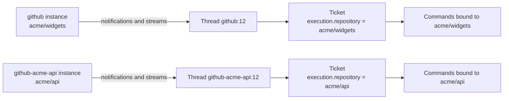

# Multi-repository support design proposal

**Status: design only; not implemented.** This document proposes how one dsh-superagent deployment can serve several GitHub repositories. It changes no runtime code, settings, prompt or deployment. Implementation needs separate authorization.

The proposal uses the domain in [001 Domain model](001-domain.md), the execution rules in [003 Execution](003-execution.md), the deployment in [006 Deployment](006-deployment.md), the extension points in [008 Cookbook](008-cookbook.md), and the module map in [007 Architecture](007-architecture.md). It is based on commit `8c32a9dc5d72c033816c6a8110b37f40cf94fba4`; every file reference below was checked against that tree, not a later revision.

## 1 The question, and the short answer

“Support multiple project repositories” can mean three different products:

1. **Several repositories, one repository per Ticket.** One dsh-superagent instance watches repositories A, B and C; a request in A produces a Ticket that clones, changes and opens a pull request in A; a request in B does the same in B. Policy, panel and worker slots are shared.
2. **One Ticket spanning several repositories.** A single request needs a change in two repositories, with two checkouts, two pull requests and a coordinated delivery.
3. **Several independent deployments.** Run one dsh-superagent per repository on the same host, each with its own state directory, port and panel.

The answer depends on the scope:

- **Scope 1 is controllable.** It is an extension of the Source and deployment layers, not a redesign of Tickets or the Executor. The estimated change is about 1,100–1,700 production lines plus 500–800 test lines, concentrated in `src/sources/`, `src/deployment.ts`, `src/app/setup.ts`, `src/infra/commands.ts` and the settings panel. It needs **no rewrite of stored records**: the existing `github` Source instance, Thread keys, Trigger ids and KV keys keep their current form. The Engine, Ticket, Mandate, Assignment and Executor lifecycles do not change.
- **Scope 2 is not a small change.** It needs an explicit multi-repository Ticket model, a prepare/checkout contract for several repositories, PR binding and delivery rules per repository, and a product decision about who chooses the repositories. It should be authorized separately after scope 1.
- **Scope 3 is possible today without code changes** and is the right temporary answer if two repositories are needed this week. Its cost is operational and grows linearly; it is not a product feature.

The shortcut that looks smallest on paper — keep one GitHub Source and turn `repository` into a list — is **more** risky than scope 1, because Thread and Trigger identity are derived from repository-local numbers. Section 3.2 explains why.

## 2 What the code assumes today

The single-repository assumption is not one setting. It appears in ten places, all outside the core domain:

| Assumption | Evidence | Effect on multiple repositories |
| --- | --- | --- |
| One repository per deployment, verified at setup | `GithubAccountsSchema.repository` and `resolveDeployment` in [deployment.ts](../src/deployment.ts) | Setup proves push access to exactly one repository |
| `Deployment.repository` is a singleton | Used by [commands.ts](../src/infra/commands.ts), [github.ts](../src/sources/github.ts), [github-pull.ts](../src/sources/github-pull.ts), [runtime.ts](../src/app/runtime.ts), [github-channel.ts](../src/sources/github-channel.ts) | Every GitHub API call, PR check and link names the same repository |
| Host GitHub calls are repository-scoped | `Commands.path()` prefixes `repos/<repository>/` and rejects absolute or foreign paths in [commands.ts](../src/infra/commands.ts) | No caller can address a second repository |
| Thread identity is repository-local | `github:<number>` in [github-trigger.ts](../src/sources/github-trigger.ts), [github.ts](../src/sources/github.ts), [github-pull.ts](../src/sources/github-pull.ts) | Issue or PR `#5` in two repositories is one Thread |
| Trigger identity is repository-local | `key('github-issue', '<number>')`, the comment fallback `github:<number>`, and `key('github-ci', …)` in [github-trigger.ts](../src/sources/github-trigger.ts) | The second repository's `#5` is a duplicate and is dropped, not stored twice |
| Polling state is global | `KV.github.*` in [kv.ts](../src/kv.ts); one `watch` and one `pollRound` in [github.ts](../src/sources/github.ts) | One notification cursor, retry map, observed-stream cursor and branch-CI record for all repositories |
| The execution environment names one repository | `DSH_SUPERAGENT_GITHUB_REPOSITORY` in [github.ts](../src/sources/github.ts), read by prepare commands and by [delivery.md](../prompts/team/delivery.md) | A worker cannot tell which repository its Ticket belongs to when more than one exists |
| PR binding compares one repository | `agentPull` in [github-pull.ts](../src/sources/github-pull.ts); `claimPull` and `pullsOf` identify a PR by number | A PR in another repository can be claimed by number alone |
| Policy, setup, health and the panel assume one instance per kind | `SourceRegistry.instances()` in [registry.ts](../src/sources/registry.ts), `SETUP_FIELDS` in [deployment.ts](../src/deployment.ts), the source cards in [source.tsx](../src/client/source.tsx) | There is no storage path or UI for a second GitHub card |
| Stored data has no repository dimension | `trigger.threads`, `trigger_thread`, `thread.key`, `decision.threadKey`, `ticket.follows`, `ticket.channels`, `outbox` in [store.ts](../src/app/store.ts) | Changing identity would require rewriting all of them |

The core model is already repository-neutral. `ThreadRef` is `{ source: string; id: string }` and `threadKey` is `` `${source}:${id}` `` ([model.ts](../src/core/model.ts)); the core never checks that `source` is a kind id. The Executor, worker slots, Mandates, Subscriptions and the Outbox know nothing about GitHub. That is why the change can stay in the Source and deployment layers.

Feishu already demonstrates the pattern: one instance serves several chats because a Feishu Thread key includes the chat id (`feishu:<chat>:<root>`). GitHub’s Thread key does not include the repository, which is exactly the gap; the two options below differ in where that dimension is added.

## 3 The options

### 3.1 A: one Source instance per repository (recommended)

A Source instance is already the domain’s configuration of a Source kind ([001 Domain model](001-domain.md)). The registry currently conflates kind and instance: `instances()` synthesizes exactly one instance per registered kind ([registry.ts](../src/sources/registry.ts)). Change it to store instances explicitly, and configure one GitHub instance per repository:

```text
settings.sources:
  github                → repository acme/widgets   (the existing installation, unchanged)
  github-acme-api       → repository acme/api       (a new instance of kind github)
  github-acme-mobile    → repository acme/mobile
```

The instance id, not the kind id, becomes `ThreadRef.source`, `Trigger.source` and `ChannelRef.source`. Because `threadKey` is `` `${source}:${id}` ``:

```text
acme/widgets #12  → Thread github:12              (unchanged for the existing installation)
acme/api     #12  → Thread github-acme-api:12     (new instance, distinct Thread)
```

No stored record is rewritten. The existing `github` instance keeps its Thread keys, Trigger ids, policy part, KV keys and settings block. New instances are additive. Policy, health, setup and the panel gain a second card, which the current settings shape already allows (`settings.sources` is a record keyed by ids matching `^[a-z][a-z0-9-]*$`).

The cost is that the registry must resolve an **instance id** rather than a **kind id** at every boundary. That is the central engineering task; section 6 sizes it.

### 3.2 B: a repository list on one GitHub Source

Config becomes `repositories: [{ name: 'acme/widgets' }, { name: 'acme/api' }]`; one instance polls all of them. On paper this is less plumbing than A. It is not, because identities collide:

```text
repo acme/widgets, issue 5 → Thread github:5, Trigger key('github-issue', '5')
repo acme/api,     issue 5 → Thread github:5, Trigger key('github-issue', '5')
```

`Intake` treats the second Trigger as a `duplicate` of the first and drops it, so only the first repository’s Thread and Ticket see the event. The two repositories’ `#5` are not distinguishable. To fix it, the Thread id, the Trigger id and every derived key must include the repository. That is not a setting change; it is a data migration across:

- `trigger.value.threads` and `trigger_thread` rows;
- `thread.key` and `thread.value.ref`;
- `decision.threadKey` and `decision.value.triggerIds`;
- `ticket.value.follows`, `ticket.value.channels` and every Subscription on a Thread;
- `outbox.value.channel.thread` and the receipts;
- `input` and `effect` rows that carry a Trigger id;
- KV keys `github-since`, `github-cursor:*`, `github-retry`, `github-stream:*`, `github-branch-ci` and `github-ci:*` ([kv.ts](../src/kv.ts)).

The Trigger id is also referenced from `ticket.origin.triggerId`, `decision.triggerIds`, Input records and stored effect payloads, so a migration must rewrite references consistently or leave old and new identities in two formats. The current migration only upgrades schema 10 to 11 ([migration.ts](../src/app/migration.ts)); adding a second identity format would be the riskiest change in this repository.

A compatibility variant (keep bare keys for the first repository, qualify the others) avoids the rewrite but permanently encodes “the primary repository is special” in the identity layer. It also means moving the primary repository later is a migration. B is therefore only attractive if the product insists on multiple repositories **inside one Source**, and even then it should be designed as a separate identity migration.

Other drawbacks of B, compared with A:

- one setup problem for all repositories: a repository without push access would fail the whole Source unless per-repository checks were added;
- one policy part, so per-repository allowed lists and admission rows are not expressible;
- one health entry, so one failing repository hides the others;
- every observed stream and cursor must be namespaced by repository anyway.

### 3.3 C: separate deployments

Run one `dsh-superagent` per repository, each with its own `stateDir`, port, profile and panel. This needs no code. It keeps all current guarantees, including setup isolation and per-repository policy, at the cost of N panels, N state directories, N bot/account configurations and duplicated prompts and allowlists. It is the recommended temporary answer, not the target.

### 3.4 D: one Ticket across repositories

The core already allows a Ticket to follow several PR Threads: `follows` is a list, `pullsOf` returns every open PR, and a Ticket ends when the PRs it follows are done ([model.ts](../src/core/model.ts), [github-pull.ts](../src/sources/github-pull.ts)). The blockers are outside the core:

- `Execution` has one `directory` and one `name`; one prepare command creates one checkout ([dsh.ts](../src/executor/dsh.ts));
- `DSH_SUPERAGENT_GITHUB_REPOSITORY` is one value in the environment ([execution-environment.ts](../src/app/execution-environment.ts));
- the worker and the prompt assume one repository (`prompts/team/delivery.md`, the GitHub skill);
- `agentPull` requires the configured repository, and `claimPull` identifies a PR by number;
- the accept path has no place to name a set of repositories;
- the review, merge and delivery rules would need per-repository policy (for example “these two PRs must land together”).

D is a product feature, not a plumbing change. It should follow A, because A gives it per-repository source identities and a Ticket-level repository field.

### 3.5 Comparison

| | A: instance per repository | B: repository list | C: separate deployments | D: cross-repository Ticket |
| --- | --- | --- | --- | --- |
| Stored-data migration | none | broad identity rewrite | none | depends on A |
| Per-repository setup isolation | yes | needs new checks | yes | yes |
| Per-repository policy | yes | no (one part) | yes | yes |
| Per-repository health | yes (phase 2) | no (one entry) | yes | yes |
| Panel | one panel, several cards | one card | N panels | one panel |
| Change size | medium | medium–large, high risk | none | large |
| Recommendation | target design | reject for now | interim | later, separately authorized |

## 4 Recommended design: A



### 4.1 Source instances

Proposed shape:

```ts
interface SourceInstance<C> {
  id: string          // stable instance id; `github` for an existing installation
  kind: string        // installed Source kind; defaults to `id` for stored records without it
  enabled: boolean
  config: C
}
```

- Add `kind` to `SourceInstanceSchema` ([policy.ts](../src/policy.ts)) with a default of the instance id. Old stored settings stay valid.
- `SourceRegistry` resolves an instance id to `{ instance, kind }`. `instances()` returns stored instances plus a default instance for every registered kind that has no stored record, which keeps today’s single-instance installation unchanged.
- An instance id is immutable after creation: Threads embed it in their keys. The panel never offers rename. Renaming would require the migration B needs.
- `SourceContext` gains the instance id and reads that instance’s config, health and setup problem. `config(id)` becomes `config()` on the instance context; a small number of call sites use it ([github.ts](../src/sources/github.ts)).
- Thread, Trigger and Channel `source` values become the instance id. The GitHub builders take the source id as a parameter instead of the constant `github` ([github-trigger.ts](../src/sources/github-trigger.ts)).
- `SourceContext.state` is scoped by instance: the `github` instance keeps the legacy KV keys; new instances get a namespaced key (`<key>@<instance>`) or instance-aware KV families. The former is smaller and keeps old cursors readable; the latter is cleaner if a migration is acceptable later.
- Health is reported per instance in the target design (`github`, `github:<instance>`), with the panel labelling the instance. Phase 1 may aggregate into the existing `github` entry and name the failing repository in its detail; per-instance entries are better for diagnosis and belong in phase 2. Per-instance entries need a dynamic `HealthBoard` claim when an instance appears and a release when it is disabled, because the kind’s fixed `health` list cannot name instances in advance.

### 4.2 Deployment and setup

- `Deployment.repository: string` becomes `repositories: Record<instanceId, string>`, with `repositoryOf(instanceId)`. Keep a derived `repository` for the existing default instance during the transition, so unmigrated call sites fail visibly rather than silently using the wrong repository.
- `resolveDeployment` ([deployment.ts](../src/deployment.ts)) resolves every GitHub instance: read the CLI, verify the account, read each repository and verify push access. Require one CLI and one account for all instances; the worker shims expose one `gh` wrapper ([environment.ts](../src/infra/environment.ts)), and supporting one account per repository would need per-repository credential selection in the prepare command.
- Setup problems become per-source: `SetupError.place` already names the Source ([setup.ts](../src/setup.ts)). An account or CLI failure is global; a repository that cannot be read or pushed to pauses only its instance. `Setup.configured()` stays “the account is resolved”, and each Source context reports its own problem.
- `SETUP_FIELDS` becomes keyed by kind (`github: ['repository', 'cli', …]`), and `setupChanged` compares every instance, including added or removed instances. A new instance therefore triggers the restart that starts its polling loop; a disabled instance does not.
- The GitHub account identity (`login`, `noreply`) is shared by all instances. `DSH_SUPERAGENT_GITHUB_ACCOUNT` and `DSH_SUPERAGENT_GITHUB_COMMIT_EMAIL` remain single values.

### 4.3 GitHub polling

GitHub notifications are account-wide, not repository-wide. Do not start a full notification reader per instance, which would duplicate calls and split the cursor:

- Read notifications once per account, keep the existing `github-since` cursor, and route each notification to the instance whose repository matches `notification.repository.full_name`. Ignore notifications for unconfigured repositories (today the reader filters them out already, [github.ts](../src/sources/github.ts)).
- Observed streams (`observeIssues`, `observePulls`, `observeComments`, `observeCi`) are per repository. Each instance runs its own streams, with its own start times, ETag and cursor, in instance-scoped state.
- Subscribed Threads are per instance: the shared `pollThreads` in [poll.ts](../src/sources/poll.ts) (imported as `pollEach`) reads `threads.subscribed(instanceId)`, and the GitHub wrapper polls each instance.
- The branch-CI Thread id becomes `<instance>:ci:<branch>`; the existing `github:ci:<branch>` stays for the default instance.
- Poll interval and failure threshold stay per instance, because they live in the instance config. Account-level rate limiting is shared; a repository with a very large history should get a longer `pollSeconds`. Report the repository in the failure detail.
- The current `watch` loop and `pollRound` become a per-instance round, except notifications, which are shared. The simplest implementation is one round per account that loops over the instances; the important invariant is one notification cursor.

### 4.4 Commands and GitHub reads

- `Commands` gains a repository-bound view: `commands.for(instanceId)` (or `withRepository(repo)`) returns a transport whose `api`/`pages` prefix that repository. The existing restriction in `Commands.path()` stays, so a caller still cannot escape to another repository by path.
- Every host caller that used to rely on the singleton passes the instance or the Ticket’s repository: the GitHub Source, `readGithub`, `readRepositoryPath`, the Executor’s PR claim, and the link builders.
- `githubAddress` already takes a repository and returns `undefined` for another one; keep that check and pass the instance’s repository.
- The worker resource syntax (`github/issues/<n>`, …) is unchanged in phase 1 and resolves against the Ticket’s repository. If a worker needs to read another repository, a later extension can accept a repository-qualified resource; it is not needed for scope 1.
- `find` ([registry.ts](../src/sources/registry.ts), [github.ts](../src/sources/github.ts)) must enumerate GitHub instances. A bare `#12` becomes ambiguous; return every instance’s Thread, and document that `owner/repo#12` is the unambiguous form.

### 4.5 The Ticket’s repository

A Ticket must know which repository it works on. Today it is implicit in `Deployment.repository`; with several repositories it must be recorded:

- Add `repository?: string` to `Execution` ([model.ts](../src/core/model.ts)). It is an execution fact, populated when the Ticket gets its `Execution` metadata. The accept decision may carry it for a Ticket whose origin has no repository; the Executor copies it into the `Execution` it creates.
- For a GitHub-origin Ticket, derive it from the origin Trigger’s Source instance (`deployment.repositoryOf(trigger.source)`). No assessment decision is needed.
- For a Feishu-origin or proactive Ticket, the acceptance must name it. Add an optional `repository` to the accept outcome ([assessment.ts](../src/app/assessment.ts), [policy.ts](../src/policy.ts)) and to the assessment prompt. Rules:
  - exactly one repository configured: default to it;
  - several configured and the origin has a repository: use it;
  - several configured and no origin repository, or a proactive rule that spans repositories: the assessment must name one; if it cannot, do not accept silently — leave the request for a clarification on its Thread.
- Existing Tickets without `execution.repository` fall back to the legacy default repository, so old state remains readable.
- Environment variables, the prepare command, PR claims and links use the Ticket’s repository ([execution-environment.ts](../src/app/execution-environment.ts), [dsh.ts](../src/executor/dsh.ts)).
- PR binding uses the Ticket’s repository, not the deployment default: `agentPull` compares the PR’s head repository with it, and `claimPull`/`observePull`/`bind` use the instance-qualified Thread (`<instance>:<number>`). PR `#7` in two repositories is then two different Threads. `pullsOf` parses the instance from the Thread key.
- `pullEndNotices` ([github-pull.ts](../src/sources/github-pull.ts)) resolves the repository of the followed Thread, not the deployment default.

### 4.6 Execution environment and prepare

- The Ticket’s `DSH_SUPERAGENT_GITHUB_REPOSITORY` is its own repository. This is the value the prepare command and the worker’s `gh --repo` calls read; [delivery.md](../prompts/team/delivery.md) already uses it.
- The main Session, which has no Ticket, needs the list: add `DSH_SUPERAGENT_GITHUB_REPOSITORIES` (one `owner/name` per line) and keep `DSH_SUPERAGENT_GITHUB_REPOSITORY` as the default repository while scope 1 is incomplete. The orchestrator prompt and the admission prompt list the repositories so the assessment can name one when needed.
- `environmentOf` must select the Ticket’s instance instead of emitting one entry per instance for the same variable keys, and the main Session must get one combined entry. `EnvironmentInput` ([kind.ts](../src/sources/kind.ts)) gains the instance id so a kind can compute per-instance values.
- The prepare command must map a repository to a local clone. The current example clones one fixed path ([006 Deployment](006-deployment.md)); a multi-repository example is:

  ```sh
  repo="$DSH_SUPERAGENT_GITHUB_REPOSITORY"
  base="$HOME/src/${repo#*/}"
  git -C "$base" fetch --no-tags "https://github.com/$repo.git" "${DSH_SUPERAGENT_GITHUB_PR_HEAD:-HEAD}:refs/dsh-superagent/$DSH_SUPERAGENT_TICKET" &&
  git -C "$base" worktree add -b "agent/$DSH_SUPERAGENT_NAME" "$DSH_SUPERAGENT_DIR" "refs/dsh-superagent/$DSH_SUPERAGENT_TICKET"
  ```

  Two owners can have a repository with the same name; the operator should choose a path that includes the owner, or a case statement. The prepare command is operator configuration, not application code, so this is documentation plus a good example.
- Worker Session directories, branch names, worker slots and background-work rules are unchanged: one Ticket still has one directory, one branch and one worker Session.

### 4.7 Policy, health and the panel

- The Policy part stays keyed by the source id returned in `actor.source` ([policy.ts](../src/policy.ts)). With instance ids, each repository gets its own `allowed`, `bots` and admission rows. The gate and Mandate revalidation already look up `settings.policy.sources[actor.source]`, so no core change is needed.
- Per-repository allowlists are the safe default: a repository with a narrower audience should not inherit another repository’s list. A “shared GitHub allowlist” mode would map instance ids to the kind for policy lookup; it is a convenience feature and should not be in phase 1. The settings UI can offer a “copy from another repository” hint.
- `Settings.syncable()` and `sync:<id>` health already work per source id ([settings.ts](../src/app/settings.ts)).
- Panel:
  - Source settings renders one card per instance. The existing `SourceSettings` maps over `settings.sources` ([source.tsx](../src/client/source.tsx)), so the list works once the registry returns instances.
  - Add a repository: the panel creates `source:<id>` with `{ kind: 'github', enabled: true, config: { repository, cli } }` and a unique id derived from the repository. Disable rather than delete in phase 1; deleting an instance leaves Threads and Tickets that refer to it and needs a retention decision.
  - Policy tab: it already renders one part per installed source ([eval.tsx](../src/client/eval.tsx)); instances appear automatically.
  - Source status and overview: one row per instance; setup problems and health per instance.
  - The `GET state` `accounts` object gains the repository list (keeping `repository` as the default for existing clients) so the deployment page can show every repository ([http.ts](../src/app/http.ts), [deployment.tsx](../src/client/deployment.tsx)).
  - Locales: source titles can include the repository; health labels need an instance suffix.

### 4.8 Prompts, skills and docs

- The worker prompt already says “the repository”; the environment section supplies the Ticket’s repository. The main prompt changes “the deployment’s repository” to “the configured repositories” and names how to choose one ([orchestrator.md](../prompts/orchestrator.md), [admission.md](../prompts/admission.md)).
- The bundled skills are selected by kind, not by instance ([sessions.ts](../src/app/sessions.ts), [prompts.ts](../src/app/prompts.ts)); no skill change is needed. `dsh-superagent-github` still describes GitHub operations and reads `$DSH_SUPERAGENT_GITHUB_REPOSITORY`.
- Update [003 Execution](003-execution.md) (variables and PR binding), [006 Deployment](006-deployment.md) (settings, Management API, prepare example, troubleshooting), [007 Architecture](007-architecture.md) (registry, deployment, commands), [SETUP.md](../SETUP.md) (questions and plan) and the README.

## 5 Compatibility and migration

Phase 1 needs **no migration**:

- the existing `github` instance id keeps its source id, Thread keys, Trigger ids, policy part, settings block and KV keys;
- `SourceInstanceSchema` gains an optional `kind` defaulting to the instance id; old settings parse;
- `Execution.repository` is optional; old Tickets fall back to the legacy default;
- new instances create new Threads and new instance-scoped KV keys only;
- rollback is disabling or removing the added instances; the existing installation is untouched.

Two rules make this hold:

1. **Never rename an instance id.** Threads, Decisions, Tickets and PR follows embed it. A rename is the same migration as option B and is unnecessary for phase 1.
2. **Never reuse a repository in two instances.** Two instances pointing at the same repository would create two Threads for one Issue; validate uniqueness of the canonical repository at save time.

If the team later wants one Source instance with a repository list (option B), that is a separate identity migration with its own design, not a follow-up refactor of phase 1.

## 6 Change map and effort

Estimates are ranges from the coupling inventory above, not measured work. They assume a developer who knows the codebase; agent assistance shortens implementation but not review or two-repository tests.

| Area | Files | Change | Production lines | Risk |
| --- | --- | --- | --- | --- |
| Instance resolution | [registry.ts](../src/sources/registry.ts), [host.ts](../src/sources/host.ts), [source-context.ts](../src/app/source-context.ts) | instance id vs kind id, per-instance config/health/problem/state | 150–250 | medium |
| Deployment and setup | [deployment.ts](../src/deployment.ts), [app/setup.ts](../src/app/setup.ts), [setup.ts](../src/setup.ts), [http.ts](../src/app/http.ts) | repository map, per-instance checks, per-instance problems, account consistency | 180–280 | medium |
| Commands | [commands.ts](../src/infra/commands.ts) | repository-bound API view; every caller passes its repository | 60–100 | low |
| GitHub source | [github.ts](../src/sources/github.ts), [github-trigger.ts](../src/sources/github-trigger.ts) | instance identity in Triggers/Threads/Channels; notification routing; per-instance streams and state | 220–350 | high (most delicate) |
| Pull, CI, channel, reads | [github-pull.ts](../src/sources/github-pull.ts), [github-channel.ts](../src/sources/github-channel.ts), [github-read.ts](../src/sources/github-read.ts), [resources.ts](../src/app/resources.ts), [tools/executor.ts](../src/app/tools/executor.ts), [assessment.ts](../src/app/assessment.ts) | repository from the Ticket or Trigger; PR claim by repository; links | 120–180 | medium |
| Environment and prompts | [execution-environment.ts](../src/app/execution-environment.ts), [prompts.ts](../src/app/prompts.ts), `prompts/*` | per-Ticket repository, repository list for the main Session | 60–100 | medium |
| Ticket repository | [model.ts](../src/core/model.ts), [assessment.ts](../src/app/assessment.ts), [policy.ts](../src/policy.ts), [dsh.ts](../src/executor/dsh.ts), [runtime.ts](../src/app/runtime.ts) | optional `Execution.repository`; accept field; derivation; fallback | 80–120 | medium |
| Panel and API | [views/settings.ts](../src/app/views/settings.ts), [views/sources.ts](../src/app/views/sources.ts), [settings.ts](../src/app/settings.ts), [source.tsx](../src/client/source.tsx), [eval.tsx](../src/client/eval.tsx), [locales.ts](../src/client/locales.ts) | instance cards, add/disable, per-instance policy and health labels | 200–320 | medium |
| Tests | `tests/*` | two-repository fixtures; identity, setup isolation, PR collision, environment, panel | 500–800 (tests) | medium |
| Docs | 003, 006, 007, SETUP, README | configuration, API, prepare example, troubleshooting | 120–200 | low |

Totals: roughly **1,100–1,700 production lines** and **500–800 test lines**. A focused implementation is about **4–6 engineering days**, plus **1–2 days** for the add/remove UI, per-instance health and documentation. The estimate is medium confidence: the identity plumbing is predictable, the panel and setup refactor are where overruns happen.

What does **not** change:

- `src/core/engine.ts`, `intake.ts`, `evals.ts`, `tickets.ts`, `assignments.ts`, `replies.ts` and `stage.ts`;
- the Ticket, Mandate, Assignment, Subscription, Input and Decision lifecycles;
- worker sessions, worker slots, background-work rules, the Outbox and delivery retries;
- the Feishu Source, apart from the shared registry/setup interfaces.

## 7 Phased plan

### P0 — interim, no code

If two repositories are needed before P1, run two deployments (option C). Document the cost: separate panels, state directories, allowlists and prompts. This is a stopgap; do not build the product on it.

### P1 — several instances, backend and minimal panel

Scope: multiple GitHub instances with one account; per-instance setup, policy, health and polling; Ticket repository; commands, reads, PR binding and environment per repository; settings pages render the instances; creation through the Management API is acceptable while the add/remove UI is pending.

Acceptance:

1. With `github` (repository A) and `github-<name>` (repository B) configured, an allowed mention in A and in B creates two Threads and two Tickets; issue `#5` in both is not merged.
2. Each Ticket’s `DSH_SUPERAGENT_GITHUB_REPOSITORY`, prepare command, PR claim and PR link name its own repository.
3. A repository without push access shows its own setup problem and does not pause the other.
4. Disabling an instance leaves its Threads and ended Tickets readable; its polling stops; the other instance keeps running.
5. The existing single-repository installation keeps its stored settings, Thread keys, Trigger ids and KV keys; the existing tests pass, with only assertions that gain the new optional fields adjusted.
6. No core Engine, Ticket or Executor behavior changes; the new `Execution.repository` is optional and old Tickets fall back to the default.

### P2 — operator experience

Scope: add/disable repository UI, per-instance health, repository-qualified search, documentation and SETUP changes, policy copy hint.

Acceptance: an operator can add a repository from the panel, sees its own health and policy card, and can diagnose a failing repository without reading logs.

### P3 — cross-repository Tickets (separate authorization)

Scope: a Ticket naming several repositories; multi-checkout prepare; PRs per repository; delivery rules. This is not covered by the estimate above and needs product decisions about who chooses the repositories, how review and merge are coordinated, and what “done” means when one PR lands before another.

## 8 Risks and open decisions

| Decision / risk | Why it matters | Recommendation |
| --- | --- | --- |
| Multiple repositories vs one Ticket across repositories | determines whether this is a medium change or a new product feature | phase 1 is multiple repositories; defer cross-repository |
| Which repository a Feishu-origin or proactive Ticket uses | there is no origin GitHub instance to derive from | name it in the accept; default when only one repository exists; otherwise ask on the Thread instead of guessing |
| Shared or per-repository allowlists | per-repository is safer but more setup work | per-repository in phase 1; add a copy hint, not an implicit share |
| One account or one account per repository | the worker shims expose one `gh`; per-repository accounts need credential selection in prepare and worker commands | one account in phase 1 |
| Health granularity | one aggregate entry hides a single failing repository | per-instance entries in phase 2; phase 1 aggregate may name the failing repository |
| Deleting or renaming an instance | instance ids are embedded in Thread keys | disable, never rename or delete in phase 1 |
| Rate limits with N repositories | notifications are one stream, but observed streams and subscribed Threads multiply | per-instance `pollSeconds`; document backoff; watch the account limit |
| Instance ids in the panel | users should not type internal ids | derive a readable id from the repository and keep it immutable |
| A repository that is archived or loses access | setup should pause only that instance | per-instance setup problem and health; do not stop the others |

## 9 Verification plan

Future implementation must cover, at minimum:

| Scenario | Expected evidence |
| --- | --- |
| Two repositories, both with issue `#5` and PR `#7` | distinct Threads, Triggers, Tickets and PR follows; no duplicate-drop |
| Notification for a configured and an unconfigured repository | the configured one becomes a Trigger; the other is ignored without an error |
| Observed streams and subscribed Threads per repository | each instance polls its own; one instance’s failure does not advance another’s cursor |
| Ticket from A reports a PR in B | rejected; the claim names the Ticket’s repository |
| PR `#7` in A and `#7` in B | each binds to its own Ticket; end notices link the right repository |
| Setup for A succeeds, B has no push access | B alone shows a setup problem; A keeps polling and working |
| Feishu-origin Ticket with one repository | defaults to that repository |
| Feishu-origin Ticket with several repositories and no named repository | no silent accept; the request waits for a clarification |
| Existing single-repository state | settings, Thread keys, Trigger ids and KV keys unchanged; all existing tests pass |
| Add or disable an instance | polling starts or stops; existing Threads and Tickets remain readable |
| Restart | cursors, retries and per-instance state survive; no replay |

This document itself is verified only as documentation: the repository’s documentation tests, the local links, the absence of conflict markers and `git diff --check`. No runtime, setup or two-repository behavior is claimed.

## 10 Code index

| Symbol / area | Where | Relevance |
| --- | --- | --- |
| `SourceInstance`, `SourceKind` | [kind.ts](../src/sources/kind.ts) | instance shape, config, fields, environment, channel, policy |
| `SourceRegistry.instances/instance/kind/scope/send/link` | [registry.ts](../src/sources/registry.ts) | instance vs kind resolution; the central refactor |
| `SourceHost.context`, `SourceContext` | [host.ts](../src/sources/host.ts) | per-instance context, health, problem, state |
| `sourceContextOf` | [source-context.ts](../src/app/source-context.ts) | construction of the per-instance context |
| `GithubAccountsSchema`, `resolveDeployment`, `SETUP_FIELDS` | [deployment.ts](../src/deployment.ts) | repository verification and setup fields |
| `Setup.run/resolve/checkAccounts` | [app/setup.ts](../src/app/setup.ts) | per-instance setup and problems |
| `Commands.api/pages/path` | [commands.ts](../src/infra/commands.ts) | repository-scoped GitHub calls |
| `githubKind`, `watch`, `pollRound`, `pollNotifications` | [github.ts](../src/sources/github.ts) | instance identity, notification routing, cursors |
| `issueTrigger`, `commentTrigger`, `ciTrigger`, `githubChannel` | [github-trigger.ts](../src/sources/github-trigger.ts) | Thread and Trigger identity |
| `readPull`, `claimPull`, `observePull`, `pullsOf`, `pullEndNotices` | [github-pull.ts](../src/sources/github-pull.ts) | PR binding by repository |
| `sendGithub`, `githubLink` | [github-channel.ts](../src/sources/github-channel.ts) | Channel address with the instance repository |
| `readGithub`, `readRepositoryPath`, `githubThreadContext` | [github-read.ts](../src/sources/github-read.ts) | reads against the right repository |
| `Execution`, `ThreadRef`, `threadKey` | [model.ts](../src/core/model.ts) | optional Ticket repository; identity unchanged |
| `environmentOf`, `ticketEnvironment` | [execution-environment.ts](../src/app/execution-environment.ts) | per-Ticket repository and main-Session list |
| `Settings`, `settingsView`, `SourceSettings` | [policy.ts](../src/policy.ts), [views/settings.ts](../src/app/views/settings.ts), [source.tsx](../src/client/source.tsx) | instance storage and panel |
| `KV.github` | [kv.ts](../src/kv.ts) | state that must be namespaced per instance |
| migration | [migration.ts](../src/app/migration.ts) | evidence that phase 1 needs no schema step |
