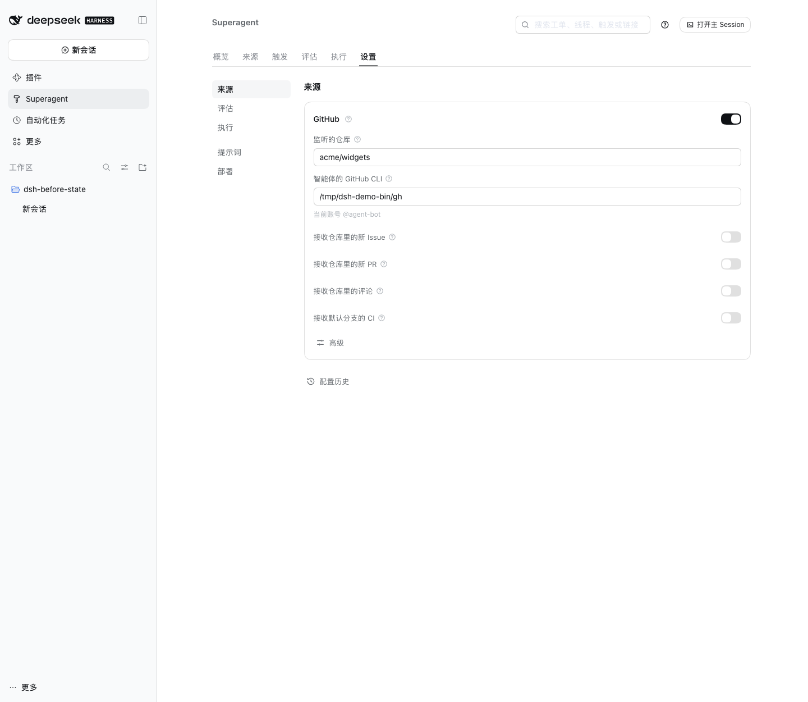
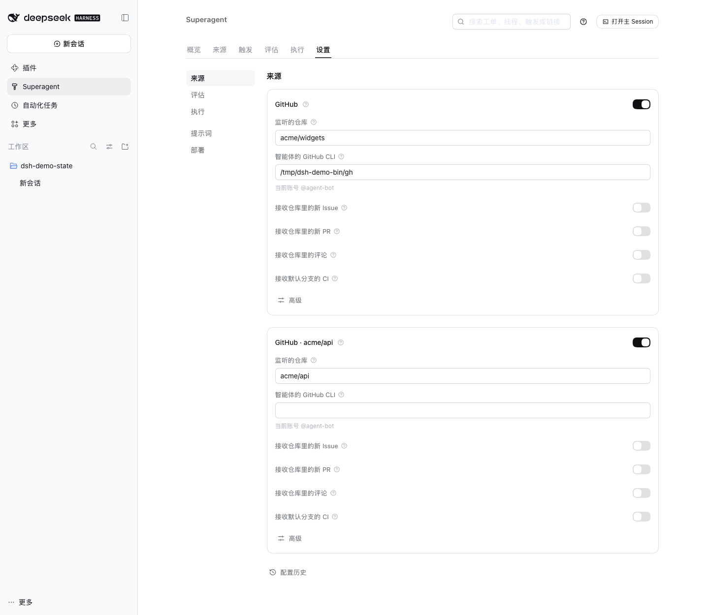

# Multi-repository support

**Status: phase 1 implemented; cross-repository Tickets are still a proposal.** This document records the design and the implementation in this pull request. One dsh-superagent deployment can now watch several GitHub repositories, with one repository per Ticket. A single Ticket that must change several repositories (multi-checkout, several pull requests, coordinated delivery) is **not** implemented and needs separate authorization.

It uses the domain in [001 Domain model](001-domain.md), the execution rules in [003 Execution](003-execution.md), the deployment in [006 Deployment](006-deployment.md), the module map in [007 Architecture](007-architecture.md), and the extension points in [008 Cookbook](008-cookbook.md). The starting point was commit `8c32a9dc5d72c033816c6a8110b37f40cf94fba4`.

## 1 The question, and the answer

“Support multiple project repositories” can mean three different products:

1. **Several repositories, one repository per Ticket.** One dsh-superagent instance watches repositories A, B and C; a request in A produces a Ticket that clones, changes and opens a pull request in A; a request in B does the same in B. Policy, panel and worker slots are shared.
2. **One Ticket spanning several repositories.** A single request needs a change in two repositories, with two checkouts, two pull requests and a coordinated delivery.
3. **Several independent deployments.** Run one dsh-superagent per repository on the same host, each with its own state directory, port and panel.

Phase 1 implements (1). It is an extension of the Source and deployment layers, not a redesign of Tickets or the Executor. It needs **no rewrite of stored records**: an existing installation keeps its `github` Source instance, Thread keys, Trigger ids and KV keys. The Engine, Ticket, Mandate, Assignment and Executor lifecycles are unchanged.

(2) is not implemented. It needs an explicit multi-repository Ticket model, a prepare contract for several checkouts, PR binding and delivery rules per repository, and a product decision about who chooses the repositories. (3) still works and is a temporary answer when a second repository is needed before phase 1 is deployed.

## 2 What the code assumed before phase 1

| Assumption | Evidence | Effect on multiple repositories |
| --- | --- | --- |
| One repository per deployment, verified at setup | `GithubAccountsSchema.repository` and `resolveDeployment` in [deployment.ts](../src/deployment.ts) | Setup proved push access to exactly one repository |
| `Deployment.repository` was a singleton | Used by [commands.ts](../src/infra/commands.ts), [github.ts](../src/sources/github.ts), [github-pull.ts](../src/sources/github-pull.ts), [runtime.ts](../src/app/runtime.ts), [github-channel.ts](../src/sources/github-channel.ts) | Every GitHub API call, PR check and link named the same repository |
| Host GitHub calls are repository-scoped | `Commands.path()` prefixes `repos/<repository>/` and rejects absolute or foreign paths in [commands.ts](../src/infra/commands.ts) | No caller could address a second repository |
| Thread identity is repository-local | `github:<number>` in [github-trigger.ts](../src/sources/github-trigger.ts), [github.ts](../src/sources/github.ts), [github-pull.ts](../src/sources/github-pull.ts) | Issue or PR `#5` in two repositories was one Thread |
| Trigger identity is repository-local | `key('github-issue', '<number>')`, the comment fallback `github:<number>`, and `key('github-ci', …)` in [github-trigger.ts](../src/sources/github-trigger.ts) | The second repository's `#5` was a duplicate and was dropped |
| Polling state was global | `KV.github.*` in [kv.ts](../src/kv.ts); one `watch` and one `pollRound` in [github.ts](../src/sources/github.ts) | One notification cursor, retry map, observed-stream cursor and branch-CI record for all repositories |
| The execution environment named one repository | `DSH_SUPERAGENT_GITHUB_REPOSITORY` in [github.ts](../src/sources/github.ts), read by prepare commands and by [delivery.md](../prompts/team/delivery.md) | A worker could not tell which repository its Ticket belonged to |
| PR binding compared one repository | `agentPull` in [github-pull.ts](../src/sources/github-pull.ts); `claimPull` and `pullsOf` identified a PR by number | A PR in another repository could be claimed by number alone |
| Policy, setup, health and the panel assumed one instance per kind | `SourceRegistry.instances()` in [registry.ts](../src/sources/registry.ts), `SETUP_FIELDS` in [deployment.ts](../src/deployment.ts), the source cards in [source.tsx](../src/client/source.tsx) | There was no storage path or UI for a second GitHub card |
| Stored data had no repository dimension | `trigger.threads`, `trigger_thread`, `thread.key`, `decision.threadKey`, `ticket.follows`, `ticket.channels`, `outbox` in [store.ts](../src/app/store.ts) | Changing identity would require rewriting all of them |

The core model is already repository-neutral. `ThreadRef` is `{ source: string; id: string }` and `threadKey` is `` `${source}:${id}` `` ([model.ts](../src/core/model.ts)); the core never checks that `source` is a kind id. The Executor, worker slots, Mandates, Subscriptions and the Outbox know nothing about GitHub. That is why the change stayed in the Source and deployment layers.

Feishu already demonstrated the pattern: one instance serves several chats because a Feishu Thread key includes the chat id (`feishu:<chat>:<root>`). GitHub’s Thread key did not include the repository; phase 1 adds that dimension through the Source instance id.

## 3 The options considered

### 3.1 A: one Source instance per repository (chosen)

A Source instance is already the domain’s configuration of a Source kind ([001 Domain model](001-domain.md)). The registry previously synthesized exactly one instance per registered kind. Phase 1 stores instances explicitly and gives each GitHub repository its own instance:

```text
settings.sources:
  github                → repository acme/widgets   (an existing installation, unchanged)
  github-acme-api       → repository acme/api       (a further instance of kind github)
  github-acme-mobile    → repository acme/mobile
```

An instance id is `<kind>` or `<kind>-<name>`; the kind is inferred from that prefix. There is no new settings field. The instance id, not the kind id, is `ThreadRef.source`, `Trigger.source` and `ChannelRef.source`. Because `threadKey` is `` `${source}:${id}` ``:

```text
acme/widgets #12  → Thread github:12              (unchanged for the existing installation)
acme/api     #12  → Thread github-acme-api:12     (a new instance, a distinct Thread)
```

No stored record is rewritten. The existing `github` instance keeps its Thread keys, Trigger ids, policy part, KV keys and settings block. New instances are additive.

### 3.2 B: a repository list on one GitHub Source (rejected)

Config would become `repositories: [{ name: 'acme/widgets' }, { name: 'acme/api' }]` with one instance polling all of them. On paper this is less plumbing than A. It is not, because identities collide:

```text
repo acme/widgets, issue 5 → Thread github:5, Trigger key('github-issue', '5')
repo acme/api,     issue 5 → Thread github:5, Trigger key('github-issue', '5')
```

`Intake` treats the second Trigger as a `duplicate` of the first and drops it. To fix it, the Thread id, the Trigger id and every derived key must include the repository, which is a data migration across `trigger.value.threads`, `trigger_thread`, `thread.key`, `decision.threadKey` and `triggerIds`, `ticket.follows` and `channels`, `outbox`, Input and effect records, and the `KV.github.*` cursors. A compatibility variant that keeps bare keys for the first repository avoids the rewrite but permanently encodes “the primary repository is special”. Phase 1 chose the additive identity instead.

### 3.3 C: separate deployments (interim)

Run one `dsh-superagent` per repository, each with its own `stateDir`, port, profile and panel. This needs no code. It keeps setup isolation and per-repository policy, at the cost of N panels, state directories and duplicated prompts and allowlists. It remains the recommended answer if two repositories must be served before this change is deployed.

### 3.4 D: one Ticket across repositories (not implemented)

The core already allows a Ticket to follow several PR Threads (`follows` is a list), but `Execution` has one `directory` and one `name`; one prepare command creates one checkout; `DSH_SUPERAGENT_GITHUB_REPOSITORY` is one value; and `agentPull`/`claimPull` bind one repository. D is a product feature, not a plumbing change. It should follow phase 1 because phase 1 supplies per-repository Source identities and a repository on each Ticket.

## 4 What phase 1 implements

### 4.1 Source instances

- `SourceInstance` is `{ id, kind, enabled, config }` ([kind.ts](../src/sources/kind.ts)). `SourceRegistry` resolves an instance id to its kind by the `kind` or `kind-<name>` prefix ([registry.ts](../src/sources/registry.ts)).
- `instances()` returns stored instances of installed kinds plus a default instance for a kind with no stored record, so an existing single-repository installation is unchanged.
- `SourceContext` carries the instance id; `config()` reads that instance; `state` keeps the legacy keys for the default instance and stores a further instance’s keys under `@<instance id>`, so cursors never mix.
- Health is reported per instance: the default instance uses the declared entry (`github`), a further instance uses `github:<instance id>`. `views/sources.ts` looks up the entry by instance; the panel labels the Source with its repository.
- `Commands.for` does not exist; `Commands.withRepository(repository)` returns a repository-bound transport, and a source context or Channel uses it only when the repository differs from the current one, so existing callers and tests keep their transport.
- An instance id is immutable after creation: Threads embed it. The panel does not offer rename.

### 4.2 Deployment and setup

- `Deployment` keeps `repository` as the default and adds `repositories: Record<instanceId, canonical repository>`; `repositoryOf(deployment, source)` and `sourceOfRepository` sit beside it ([deployment.ts](../src/deployment.ts)).
- `resolveDeployment` reads every GitHub instance, verifies each repository and requires one CLI and one account. A failed repository records a problem for that instance and leaves the others usable; a failed account or CLI is global. `Setup.problems` holds the per-instance problems and `Setup.problemFor(id)` serves them to a Source context.
- `SETUP_FIELDS` is keyed by kind, and `setupChanged` compares the instance ids and each instance’s setup fields. Adding an instance restarts dsh-superagent; switching a receiving option does not. `checkAccounts` verifies a saved instance and refuses a further instance that would introduce another account or CLI.

### 4.3 GitHub polling and identity

- The plugin starts one polling loop per configured GitHub instance ([github.ts](../src/sources/github.ts)). `pollNotifications` uses GitHub’s **repository** notifications endpoint (`GET /repos/{owner}/{repo}/notifications`), so each instance has its own cursor and retry map; the repository filter remains as a guard.
- Observed streams, the default-branch CI record and subscribed Threads are per instance, in instance-scoped state.
- Trigger builders take the instance id: the Issue/PR id is repository-qualified for a further instance and keeps its old form for `github`; the Thread is `<instance>:<number>`; the Channel names the instance.
- PR binding is per instance: `agentPull` checks the PR head against the instance’s repository, `pullsOfSource` reads only that instance’s followed Threads, and `claimPull`, `observePull`, `bind`, `closePull` and `pullEndNotices` use the instance id and its canonical repository.

### 4.4 A Ticket’s repository

- `Execution` gained an optional `repository` ([model.ts](../src/core/model.ts)). For a GitHub-origin Ticket it is derived from the origin Trigger’s Source instance; for an explicit routed accept it can be passed to `orchestrator_route`; for an assessed accept it can be passed to `orchestrator_eval_decide`. A Ticket whose work is unrelated to every repository and needs no pull request is accepted with `workspace_only`: it has no repository and an empty workspace instead of a checkout ([repository-less-tickets.md](repository-less-tickets.md)).
- `MasterAssessor.decide` derives a GitHub origin’s repository, rejects an unconfigured repository, and refuses an accept when several repositories are configured and the request has no origin repository and names none. A workspace-only accept is the explicit alternative to naming one. The main Session is expected to ask the requester which repository for repository work, then accept with that repository.
- Existing Tickets without `execution.repository` fall back to the default repository, so old state remains readable. A workspace-only Ticket is marked by `execution.workspaceOnly`, not by the absence of a repository.

### 4.5 Execution environment and prepare

- `DSH_SUPERAGENT_GITHUB_REPOSITORY` is the Ticket’s repository; the new `DSH_SUPERAGENT_GITHUB_REPOSITORIES` is every configured repository, one per line, which the main Session uses to choose. The account and commit email stay single values.
- A prepare command maps the repository to a local clone. For example:

  ```sh
  repo="$DSH_SUPERAGENT_GITHUB_REPOSITORY"
  base="$HOME/src/${repo#*/}"
  git -C "$base" fetch --no-tags "https://github.com/$repo.git" "${DSH_SUPERAGENT_GITHUB_PR_HEAD:-HEAD}:refs/dsh-superagent/$DSH_SUPERAGENT_TICKET" &&
  git -C "$base" worktree add -b "agent/$DSH_SUPERAGENT_NAME" "$DSH_SUPERAGENT_DIR" "refs/dsh-superagent/$DSH_SUPERAGENT_TICKET"
  ```

  A clone per repository is needed; two owners can have the same repository name, so the operator should include the owner in the path or use a case statement.
- Worker Sessions, directories, branches, worker slots and background-work rules are unchanged: one Ticket still has one directory and one branch.

### 4.6 Policy, health and the panel

- The Policy part stays keyed by `actor.source`, so each instance has its own allowed list, bot list and admission rows ([policy.ts](../src/policy.ts)). A shared list across repositories is not implemented; the panel can copy entries by hand.
- The sources settings render one card per instance; the policy tab renders one part per installed instance. Setup problems are shown on their instance, and an instance’s own health entry keeps a failing repository from hiding the others.
- **Adding a repository** is currently done through the Management API, not a panel button: create a block named `source:github-<name>` with a revision of `0` and a value such as `{"enabled": true, "config": {"repository": "acme/api", "cli": ""}}`. An empty `cli` inherits the deployment’s agent CLI. The save verifies the new repository and restarts dsh-superagent. Disabling the block stops that repository’s polling; there is no delete UI, because Threads and Tickets still refer to the instance.
- Each Source card shows its repository, and the Management API exposes the repository list in the setup accounts (`repositories`) and the per-instance problems (`problems`).

### 4.7 Prompts and docs

The environment section of the prompt carries the Ticket’s repository and the configured repository list ([execution-environment.ts](../src/app/execution-environment.ts), [github.ts](../src/sources/github.ts)). The main prompt and the admission prompt tell the Session to name a repository when a request has no GitHub origin and several are configured. The GitHub skill still uses `$DSH_SUPERAGENT_GITHUB_REPOSITORY`, now the Ticket’s repository.

## 5 Compatibility and migration

Phase 1 needs **no migration**:

- the existing `github` instance id keeps its Thread keys, Trigger ids, policy part, settings block and KV keys;
- `SourceInstanceSchema` is unchanged; a further instance is an ordinary settings record;
- `Execution.repository` is optional; an old Ticket falls back to the default repository;
- new instances create new Threads and new instance-scoped KV keys only;
- rollback is disabling or removing the added instances; the existing installation is untouched.

Two rules keep this true: **never rename an instance id** (Threads, Decisions, Tickets and PR follows embed it), and **never reuse a repository in two instances** (`resolveDeployment` records a duplicate repository as a problem).

## 6 Verification

### Visual evidence

The Sources settings page, at the same viewport (1440×1250), default light theme and Chinese locale, in two real dsh-superagent instances:

**Before** — the previous build, one GitHub repository:



**After** — this build, two GitHub repositories, one Source instance each:



Both captures use a temporary local deployment with a stub `gh` CLI and fictional `acme/widgets` and `acme/api` repositories; no real credentials, private Feishu content or production state is shown.

The implementation is covered by the existing suites plus [multi-repo.spec.ts](../tests/multi-repo.spec.ts):

| Scenario | Covered by |
| --- | --- |
| Instance resolution, per-instance scope, links and search | `tests/multi-repo.spec.ts`, `tests/registry.spec.ts` |
| Issue `#5` and a comment on it in two repositories | `tests/multi-repo.spec.ts`, `tests/sources.spec.ts` |
| Per-repository setup, one failing repository isolated, CLI mismatch | `tests/multi-repo.spec.ts`, `tests/deployment.spec.ts` |
| Per-Ticket repository and the main Session’s repository list | `tests/multi-repo.spec.ts` |
| Adding an instance restarts setup; a receiving switch does not | `tests/multi-repo.spec.ts`, `tests/settings.spec.ts` |
| PR and Thread binding by repository | `tests/multi-repo.spec.ts`, `tests/sources.spec.ts` |
| Existing single-repository behavior | the existing Source, Runtime, Registry, Command, Panel and Migration suites |

`pnpm check` runs the typecheck, the full test suite and the build.

## 7 Remaining work

| Phase | Scope | Status |
| --- | --- | --- |
| P1 | Several instances; per-instance setup, policy, health, polling; Ticket repository; Commands, reads, PR binding and environment per repository; panel renders instances; Management API creation | Implemented |
| P2 | Add/disable repository UI, repository-qualified search hints, a shared-allowlist option, docs and SETUP polish | Not implemented |
| P3 | One Ticket across several repositories: multi-checkout prepare, PRs per repository, coordinated delivery | Not implemented; separate authorization |

## 8 Risks and decisions

| Decision / risk | Why it matters | Current choice |
| --- | --- | --- |
| Multiple repositories vs one Ticket across repositories | determines whether this is a medium change or a new product feature | phase 1 is multiple repositories; cross-repository deferred |
| Which repository a Feishu-origin or proactive Ticket uses | there is no origin GitHub instance to derive from | name it in the accept; default when only one is configured; otherwise the main Session asks instead of guessing, or accepts as `workspace_only` when the work needs no repository and no pull request |
| Shared or per-repository allowlists | per-repository is safer but more setup work | per-repository; no implicit share |
| One account or one account per repository | the worker shims expose one `gh` | one account; a further instance inherits the CLI and may not introduce another account |
| Health granularity | one aggregate entry hides a single failing repository | per-instance entries |
| Deleting or renaming an instance | instance ids are embedded in Thread keys | disable, never rename; no delete UI yet |
| Rate limits with N repositories | notifications are per repository; observed streams and subscribed Threads multiply | per-instance `pollSeconds`; watch the account limit |
| Adding an instance without a panel form | operators need the Management API | documented in section 4.6; a panel form is P2 |

## 9 Code index

| Symbol / area | Where | Relevance |
| --- | --- | --- |
| `SourceInstance`, `SourceKind` | [kind.ts](../src/sources/kind.ts) | instance shape, config, environment, channel, policy |
| `SourceRegistry.kindId/instances/instancesOfKind/instance/kind` | [registry.ts](../src/sources/registry.ts) | instance vs kind resolution, per-instance health and state |
| `SourceHost.context`, `SourceContext` | [host.ts](../src/sources/host.ts) | per-instance context |
| `sourceContextOf` | [source-context.ts](../src/app/source-context.ts) | instance config, state scoping, repository-bound commands |
| `GithubAccountsSchema`, `resolveDeployment`, `resolveGithubInstance`, `SETUP_FIELDS` | [deployment.ts](../src/deployment.ts) | repository map, per-instance checks |
| `Setup.run/resolve/checkAccounts/problemFor` | [app/setup.ts](../src/app/setup.ts) | per-instance setup problems |
| `Commands.withRepository` | [commands.ts](../src/infra/commands.ts) | repository-scoped GitHub calls |
| `githubKind`, `watchAll`, `watchInstance`, `pollRound` | [github.ts](../src/sources/github.ts) | one loop per instance, cursors and health |
| `issueTrigger`, `commentTrigger`, `ciTrigger`, `githubChannel` | [github-trigger.ts](../src/sources/github-trigger.ts) | instance-scoped identity |
| `agentPull`, `claimPull`, `observePull`, `pullsOfSource`, `pullEndNotices` | [github-pull.ts](../src/sources/github-pull.ts) | PR binding per repository |
| `sendGithub`, `githubLink` | [github-channel.ts](../src/sources/github-channel.ts) | Channel address and repository link |
| `readGithub`, `readRepositoryPath`, `githubThreadContext` | [github-read.ts](../src/sources/github-read.ts) | reads against the right repository |
| `Execution`, `ThreadRef`, `threadKey` | [model.ts](../src/core/model.ts) | optional Ticket repository; unchanged identity |
| `environmentOf`, `ticketEnvironment` | [execution-environment.ts](../src/app/execution-environment.ts) | per-Ticket repository and main-Session list |
| `Settings.save/checkAccounts`, `settingsView`, `SourceSettings` | [policy.ts](../src/policy.ts), [app/settings.ts](../src/app/settings.ts), [views/settings.ts](../src/app/views/settings.ts), [source.tsx](../src/client/source.tsx) | instance storage and panel |
| `KV.github` | [kv.ts](../src/kv.ts) | state namespaced per instance through `SourceContext.state` |
| [multi-repo.spec.ts](../tests/multi-repo.spec.ts) | tests | the phase 1 scenarios above |
